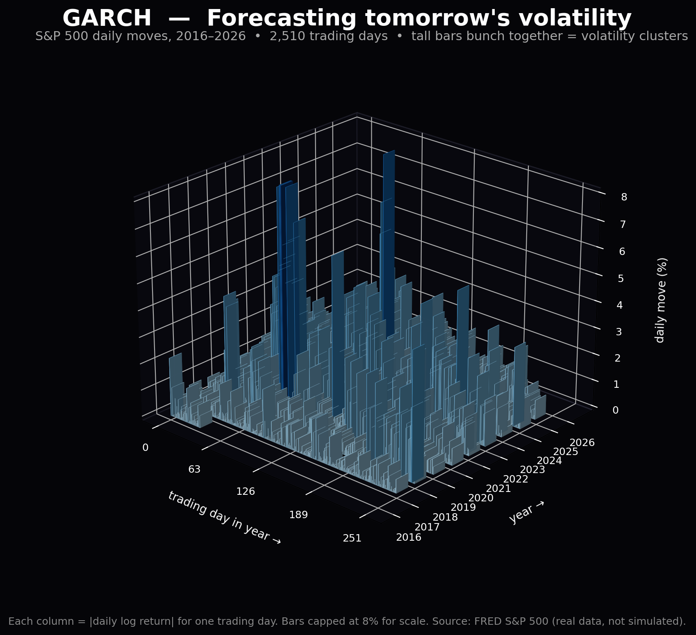

# GARCH Volatility Lab

Volatility clustering, reproduced from a TikTok, then tested on real data.

**Source idea:** [@quantfinancetogo, "Quantitative Finance from Scratch, part 39: GARCH"](https://www.tiktok.com/@quantfinancetogo/video/7703521589966408992) — calm weeks follow calm weeks, big moves arrive in groups.

**Why this repo exists:** the video's model is clean, but its data is simulated, so clustering is built in by design, and its symmetric model leaves out the real-market fact that falls move volatility more than rises. This repo reproduces the video exactly, then does the two things that make it a real project: fit to real returns, and fix the asymmetry.

## The model

GARCH(1,1), returns in percent per day, variance in percent-squared:

```
sigma^2_t = omega + alpha * eps^2_{t-1} + beta * sigma^2_{t-1}
```

Video parameters: `omega = 0.05, alpha = 0.10, beta = 0.85`, baseline volatility 1%/day.

Worked example from the video: a 4% drop on a calm day gives tomorrow's variance `0.05 + 0.10 × 16 + 0.85 × 1 = 2.50`, so volatility jumps to **1.58%**. With no new shocks it decays back toward 1%: day 5 = 1.49%, day 10 = 1.39%, day 30 = 1.16%. Excess variance halves every ~13.5 trading days.

GJR-GARCH adds the asymmetry term the video flags as missing:

```
sigma^2_t = omega + alpha * eps^2_{t-1}
            + gamma * eps^2_{t-1} * 1[eps_{t-1} < 0]
            + beta * sigma^2_{t-1}
```

## What it does

1. **Reproduce** — `python src/reproduce_tiktok.py` verifies the shock, the decay curve, the half-life, and the clustering statistic on simulated data (video, 1,000,000 days: >2.5% moves 1.75% overall vs 10.97% the day after one, ~6.3×).
2. **Fit real data** — `python src/fit_real_data.py spy.us` downloads daily closes from Stooq (free, no key; falls back to FRED's S&P 500 series if Stooq bot-blocks, as it did from this machine), fits GARCH(1,1) and GJR-GARCH(1,1) by Gaussian MLE (implemented here with scipy, no `arch` dependency), and holds out the last 252 trading days.
3. **Backtest** — 1-day 95% VaR on the held-out window, using the video's normal approximation (VaR = 1.65 × forecast volatility). Good coverage means ~5% violations; the gap between expected and observed is the result, not a chart.
4. **Use it** — risk managers update VaR with the forecast; some funds scale positions down as forecast volatility rises. This repo reports the forecast, it does not trade on it.

## Run

```bash
pip install -r requirements.txt
python src/reproduce_tiktok.py
python -m pytest tests/ -q
python src/fit_real_data.py spy.us        # needs internet (Stooq)
python src/fit_real_data.py --simulated   # no internet needed
```

## Results

Real run, FRED S&P 500, 2016-11-04 to 2026-11-02 (2,510 returns, last 252 held out):

| Model | In-sample log-likelihood | Held-out VaR violations (expected 5%) |
|---|---|---|
| GARCH(1,1) | -2953.9 | 6.35% (16/252) |
| GJR-GARCH(1,1) | -2912.1 | 4.37% (11/252) |

GJR-GARCH wins on both: higher likelihood, and closer to 5% coverage. Its gamma of 0.224 means a negative shock hits next-day variance ~6.3× harder than an equal positive one — the asymmetry the TikTok video said its simple model leaves out. Full detail in `EVALUATION.md`.

## Visual: volatility clustering, real data



Each column is |daily log return| for one trading day, gridded as trading day in year × year — 2,510 days, 2016–2026, source FRED S&P 500 (real data, not simulated). Tall bars bunching together are volatility clusters, clearest in 2020 and 2022. Bars are capped at 8% for scale (max day was 12.77%). Generated by `python src/plot_3d.py` — rerun it on any CSV in the same format to regenerate this image.

## Limitations (stated, not buried)

- Gaussian innovations: real returns have fatter tails than normal, so a normal VaR understates extreme moves.
- GARCH(1,1) is symmetric; GJR-GARCH helps, but neither captures every regime shift.
- Stooq closes are unadjusted; dividends/splits can show up as spurious jumps.
- Education only, not financial advice. Nothing here is a trading signal.

## Structure

```
src/garch.py            core: simulation, forecasts, MLE fit, VaR backtest
src/reproduce_tiktok.py step-by-step reproduction of the video's numbers
src/fit_real_data.py    real-data fit + held-out VaR backtest
src/plot_3d.py          3D volatility landscape plot (dark, blue columns)
assets/garch_3d.png     that plot, embedded above
tests/test_garch.py     shock, decay, clustering, fit-recovery tests
EVALUATION.md           what counts as "this works" before shipping
```
